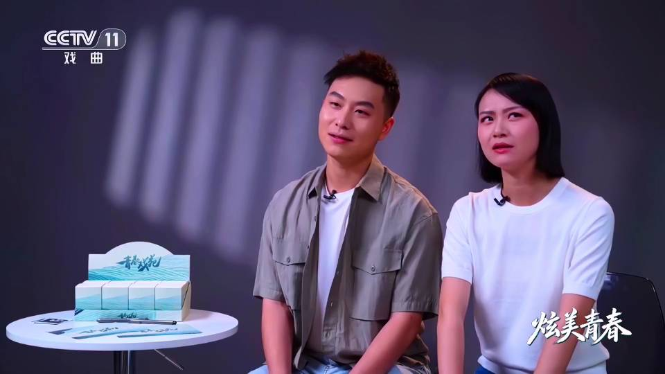

# TV Screen Stream

把一台 **小米电视 EA55 2022 款（Amlogic T5 / Android 9 / 已 root）** 的**实时画面 + 声音**推到浏览器里看。
端口 8899，一个网页搞定，支持切分辨率、切音源、远程唤醒/息屏。



> 上面这张不是截图软件的产物，是从电视**硬件视频层**回采到的原始帧，分辨率 960×540。

---

## 它解决什么问题

普通截屏手段在这类电视上**抓不到视频画面**：

| 方案 | 结果 | 原因 |
|---|---|---|
| `adb shell screencap` | ❌ 全黑 | 视频走独立硬件层，不经 SurfaceFlinger 合成 |
| `MediaProjection` / `scrcpy` | ❌ 全黑 | 同上 |
| **厂商 `screencontrol` 硬件回采** | ✅ **完整画面** | 直接从 AML screen source（VDIN）取显示管线输出 |

本项目用的是最后一种。

## 快速开始

前提：电视已 root（Magisk），和你的电脑同一个局域网。

```bash
# 1. 构建 dex（需要 JDK 17 + Android SDK build-tools）
bash tools/build.sh

# 2. 推到电视
adb push build/classes.dex /data/local/tmp/sc.dex
adb push tools/run_srv.sh   /data/local/tmp/
adb push tools/stop_srv.sh  /data/local/tmp/

# 3. 启动（宽 高 端口）
adb shell su -c 'sh /data/local/tmp/run_srv.sh 960 540 8899'

# 4. 浏览器打开
#    http://<电视IP>:8899/
```

停止：

```bash
adb shell su -c 'sh /data/local/tmp/stop_srv.sh'
```

## 功能

| 功能 | 说明 |
|---|---|
| 实时画面 | MJPEG / 裸 JPEG 流，网页用 canvas 渲染 |
| 实时声音 | 从 ALSA `LOOPBACK-A` 回采，48kHz 立体声 |
| 分辨率切换 | 网页下拉框实时切换，320×180 ~ 1920×1080 |
| 声音来源 | 电视扬声器 / 麦克风 / SPDIF 输入，可切 |
| 远程唤醒 / 息屏 | 网页按钮，等价于遥控器电源键 |
| 状态上报 | `/stats` 返回 fps、带宽、分辨率、在线人数、醒睡状态 |

## 实测性能

| 输出分辨率 | 帧率 | 带宽 |
|---|---|---|
| 320×180 | ~18 fps | 2.1 Mbps |
| 480×270 | ~17 fps | 3.8 Mbps |
| 640×360 | ~15 fps | 4.8 Mbps |
| **960×540** | **~8.7 fps** | **5.0 Mbps** |
| 1280×720 | ~6 fps | — |
| 1920×1080 | ~3.3 fps | — |

瓶颈在厂商接口：**每次采集都要重启一次 screen source**，固定开销约 30–33 ms 等源端出帧，
拷贝带宽约 30 MB/s。所以分辨率是唯一有效杠杆。

## ⚠️ 适用范围

**这套东西只适用于 Amlogic 芯片 + 已 root 的电视。** 换芯片平台（MediaTek / Realtek / 海思）
就完全用不了，因为底层依赖的是 Amlogic 私有服务。

详见 [docs/UNIVERSALITY.md](docs/UNIVERSALITY.md)。当前只在**一台**设备上验证过，
配置见 [docs/DEVICE.md](docs/DEVICE.md)。

## 文档

### 给人看

| 文档 | 内容 |
|---|---|
| [docs/DEVICE.md](docs/DEVICE.md) | **这台电视的完整配置**（型号、SoC、编解码器、音频、分区） |
| [docs/HOW-IT-WORKS.md](docs/HOW-IT-WORKS.md) | 回采链路原理、为什么 screencap 是黑的 |
| [docs/API.md](docs/API.md) | HTTP 接口说明 |
| [docs/BUILD.md](docs/BUILD.md) | 构建流程（含 native 交叉编译的坑） |
| [docs/PITFALLS.md](docs/PITFALLS.md) | **踩过的所有坑**（sourceType=2 会让守护进程崩溃等） |
| [docs/MEASUREMENTS.md](docs/MEASUREMENTS.md) | 全部实测数据与方法 |
| [docs/UNIVERSALITY.md](docs/UNIVERSALITY.md) | 能用到哪些机器、不能用到哪些 |

### 给 AI 看

| 文件 | 用途 |
|---|---|
| [AGENTS.md](AGENTS.md) | 接手契约：状态分级、硬约束、验证情况、禁止事项 |
| [llms.txt](llms.txt) | 项目速查（llms.txt 约定） |
| [ai/facts.json](ai/facts.json) | 结构化事实：设备参数、实测数字、已知问题 |

## 目录结构

```
src/com/droidlogic/app/
  ScreenControlManager.java   主程序：回采管线 + HTTP 服务 + 网页
  AudioStream.java            声音回采（tinycap → FIFO → 下混 2ch）
  H264Stream.java             H.264 推流实验（TS over HTTP）
  TsMuxer.java                手写 MPEG-TS 封装
  TsCheck.java                用软解验证 TS 是否可解
tools/
  build.sh                    javac + d8 出 dex
  native-build.sh             armeabi-v7a 交叉编译（clang-cl + lld）
  run_srv.sh / stop_srv.sh    电视上启停
docs/                         文档
docs/decisions/               架构决策记录（ADR）
```

## 已知限制

- **没有鉴权、没有 TLS**。只能在内网用，禁止映射到公网。
- 帧率上限 ~18 fps，因为厂商接口的固定开销。
- 这台机器**没有硬件 H.264 编码器**（软件编码只有 26 fps @480p），H.264 推流比 MJPEG 更慢。
- 电视息屏后采不到画面（显示管线停了），需要先唤醒。
- 依赖 root。

## 许可

未定。如果要用，请先联系作者。

## 致谢

踩坑过程中确认的几个关键事实来自对 `libscreencontrolservice.so` 的反汇编，
相关结论写在 [docs/HOW-IT-WORKS.md](docs/HOW-IT-WORKS.md)。
